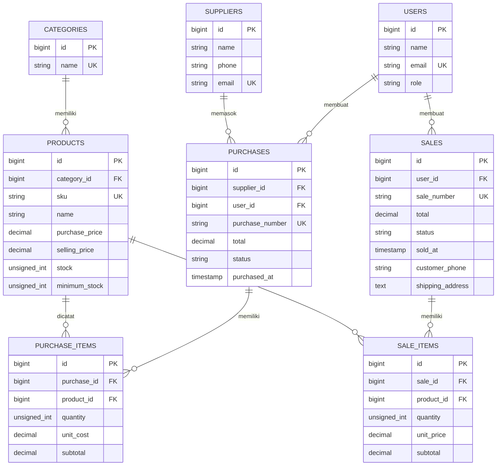

# Paw Pantry

Paw Pantry adalah aplikasi web inventaris dan penjualan untuk toko makanan kucing. Katalog contoh berisi produk dari merek yang tersedia di toko hewan dan klinik veteriner, sementara dashboard merangkum penjualan, tren mingguan, dan kebutuhan restock.

## Fitur

- Login dengan peran Admin/Owner, Staff, dan Pelanggan.
- Pendaftaran akun pelanggan dengan akses terpisah dari panel internal.
- Katalog online yang dapat dicari dan difilter berdasarkan kategori.
- Checkout mandiri dengan informasi pengiriman, validasi stok real-time, dan riwayat pembelian.
- Faktur pesanan yang dapat dicetak dari browser.
- Pengelolaan produk, kategori, pemasok, dan pengguna.
- Katalog contoh makanan kering, makanan basah, dan diet veteriner.
- Pencatatan pembelian dan penjualan dengan perubahan stok atomik.
- Peringatan stok minimum, pencarian produk, filter kategori, dan laporan transaksi.
- Pembatalan transaksi oleh Admin dengan validasi pemulihan stok.
- Dashboard ringkas dengan tren penjualan 7 hari dan daftar restock.

## Teknologi

- Laravel 12 dan PHP 8.2+
- MySQL 8+ atau MariaDB yang kompatibel, dengan ekstensi PHP `pdo_mysql`
- Blade, CSS responsif, Node.js, dan npm

## Entity Relationship Diagram (ERD) & Relasi Eloquent

Database Paw Pantry menggunakan pola transaksi **header-detail**. Tabel `purchases` dan `sales` menyimpan header transaksi, sedangkan `purchase_items` dan `sale_items` menyimpan produk, jumlah, harga satuan, dan subtotal. Stok produk diperbarui ketika transaksi dibuat atau dibatalkan.



### Relasi model Eloquent

| Model          | Relasi      | Model tujuan   | Keterangan                                                                                                |
| -------------- | ----------- | -------------- | --------------------------------------------------------------------------------------------------------- |
| `Category`     | `hasMany`   | `Product`      | Satu kategori memiliki banyak produk.                                                                     |
| `Product`      | `belongsTo` | `Category`     | Produk berada dalam satu kategori.                                                                        |
| `Product`      | `hasMany`   | `PurchaseItem` | Produk dapat muncul di banyak detail pembelian.                                                           |
| `Product`      | `hasMany`   | `SaleItem`     | Produk dapat muncul di banyak detail penjualan.                                                           |
| `Supplier`     | `hasMany`   | `Purchase`     | Satu pemasok memiliki banyak pembelian.                                                                   |
| `Purchase`     | `belongsTo` | `Supplier`     | Pembelian berasal dari satu pemasok.                                                                      |
| `Purchase`     | `belongsTo` | `User`         | Pembelian dibuat oleh satu pengguna/staf.                                                                 |
| `Purchase`     | `hasMany`   | `PurchaseItem` | Header pembelian memiliki banyak detail item.                                                             |
| `PurchaseItem` | `belongsTo` | `Purchase`     | Detail item terkait satu pembelian.                                                                       |
| `PurchaseItem` | `belongsTo` | `Product`      | Detail pembelian mengacu pada satu produk.                                                                |
| `User`         | `hasMany`   | `Purchase`     | Pengguna dapat membuat banyak pembelian.                                                                  |
| `User`         | `hasMany`   | `Sale`         | Pengguna dapat membuat banyak penjualan.                                                                  |
| `Sale`         | `belongsTo` | `User`         | Penjualan dibuat oleh satu pengguna; pelanggan online juga memakai entitas `User` dengan role `customer`. |
| `Sale`         | `hasMany`   | `SaleItem`     | Header penjualan memiliki banyak detail item.                                                             |
| `SaleItem`     | `belongsTo` | `Sale`         | Detail item terkait satu penjualan.                                                                       |
| `SaleItem`     | `belongsTo` | `Product`      | Detail penjualan mengacu pada satu produk.                                                                |

### Aturan penghapusan data

- `categories`, `suppliers`, dan `users` menggunakan `restrictOnDelete`, sehingga data induk yang masih direferensikan tidak dapat dihapus.
- `products` pada detail transaksi juga menggunakan `restrictOnDelete` untuk menjaga riwayat pembelian dan penjualan.
- `purchase_items` dan `sale_items` menggunakan `cascadeOnDelete`; detail ikut terhapus jika header transaksinya dihapus.
- Aplikasi memblokir penghapusan produk yang sudah memiliki detail transaksi melalui `ProductController`.

## Menjalankan aplikasi

Pastikan PHP 8.2+, Composer, MySQL/MariaDB, Node.js, dan npm sudah terpasang.

```bash
# 1. Clone repository (ganti URL dengan alamat repository UTS_MK_WEB)
git clone <repository-url>
cd UTS_MK_WEB

# 2. Salin konfigurasi environment
cp .env.example .env

# 3. Generate application key
php artisan key:generate

# 4. Install dependensi PHP
composer install
```

### Konfigurasi database Paw Pantry

```bash
# 5. Buat database MySQL
Buat database kosong paw_pantry pada MySQL/MariaDB. Contoh melalui MySQL client
```

Kemudian buka `.env` dan sesuaikan koneksi database:

```dotenv
DB_CONNECTION=mysql
DB_HOST=127.0.0.1
DB_PORT=3306
DB_DATABASE=paw_pantry
DB_USERNAME=root
DB_PASSWORD=
```

Jalankan migration, seeder, dan build frontend:

```bash
# 6. Buat tabel dan isi data demo
php artisan migrate --seed

# 7. Install dan bundle frontend
npm install
npm run build

# 8. Jalankan server lokal
php artisan serve
```

Buka `http://127.0.0.1:8000`.

### Akun demonstrasi

| Peran         | Email                | Kata sandi |
| ------------- | -------------------- | ---------- |
| Admin / Owner | `owner@example.test` | `password` |
| Staff         | `staff@example.test` | `password` |

## Fitur pelanggan

1. Buka `http://127.0.0.1:8000/shop` untuk melihat katalog produk yang stoknya tersedia.
2. Pilih **Daftar**, isi nama, email, dan password; pelanggan juga dapat memakai tautan **Masuk** jika sudah memiliki akun.
3. Pilih produk melalui tombol **Pesan**, atur jumlah, lalu isi nomor telepon dan alamat pengiriman pada checkout.
4. Setelah pesanan dibuat, stok langsung diperbarui dan pesanan tersimpan pada menu **Pesanan saya**.
5. Buka **Lihat faktur** dari riwayat, kemudian tekan **Cetak faktur** untuk mencetak atau menyimpan sebagai PDF melalui dialog browser.


Referensi produk:

- [Royal Canin Indonesia](https://www.royalcanin.com/id)
- [Purina Indonesia](https://www.purina.co.id/)
- [Hill's Pet Nutrition Indonesia](https://www.hillspet.co.id/)
- [Whiskas Indonesia](https://www.whiskasindonesia.com/)
- [Me-O](https://www.me-o.com/)
- [Sheba](https://www.sheba.com/)

## Alur demo

1. Masuk dengan akun Admin, lalu tinjau dashboard, katalog, dan produk berstok rendah.
2. Buat transaksi pembelian untuk menambah stok.
3. Buat transaksi penjualan; harga satuan diambil dari master produk dan stok diperiksa di server.
4. Coba menjual melebihi stok untuk melihat validasi.
5. Batalkan penjualan sebagai Admin untuk melihat stok dipulihkan.
6. Masuk sebagai Staff untuk melihat batas akses pengelolaan master dan pengguna.

## Data dan integritas stok

Pembelian dan penjualan disimpan bersama detail item dan snapshot harga satuan. Total dihitung ulang oleh server. Perubahan stok berlangsung dalam transaksi database; penjualan dengan stok tidak cukup ditolak tanpa menyimpan sebagian perubahan. Riwayat yang telah dibatalkan tetap disimpan. Produk yang sudah terkait dengan transaksi tidak dapat dihapus.

Relasi utama: kategori memiliki banyak produk; pemasok memiliki banyak pembelian; pengguna membuat transaksi; pembelian dan penjualan memiliki detail item yang merujuk ke produk.

## Pengujian

Jalankan pengujian dengan SQLite in-memory:

```bash
php artisan test
```

Feature test mencakup autentikasi dan otorisasi, pendaftaran pelanggan, checkout mandiri, validasi stok, privasi faktur, pembelian, penjualan, rollback stok, pembatalan, pencarian/filter katalog, dan laporan.
